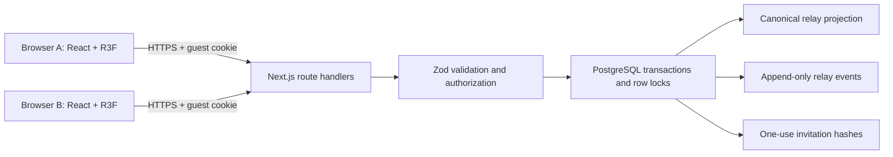

# Architecture

The server is authoritative. Guest tokens are random 32-byte values in httpOnly SameSite=Lax cookies; only SHA-256 hashes are stored. Relay creation, evolution, invite, and claim use PostgreSQL transactions. Evolution applies a pure deterministic reducer and writes the projection plus event atomically. Mutations use UUID request IDs to make retries return their original result. Invites are fragment tokens with a deterministic HMAC construction for retry recovery; only SHA-256 token hashes are persisted.

Each event sequence equals the resulting relay version. Every mutation (including invitations and transfers) advances both. The event stores the resulting state, so the journey can replay historical character appearances without reconstructing from current state.
